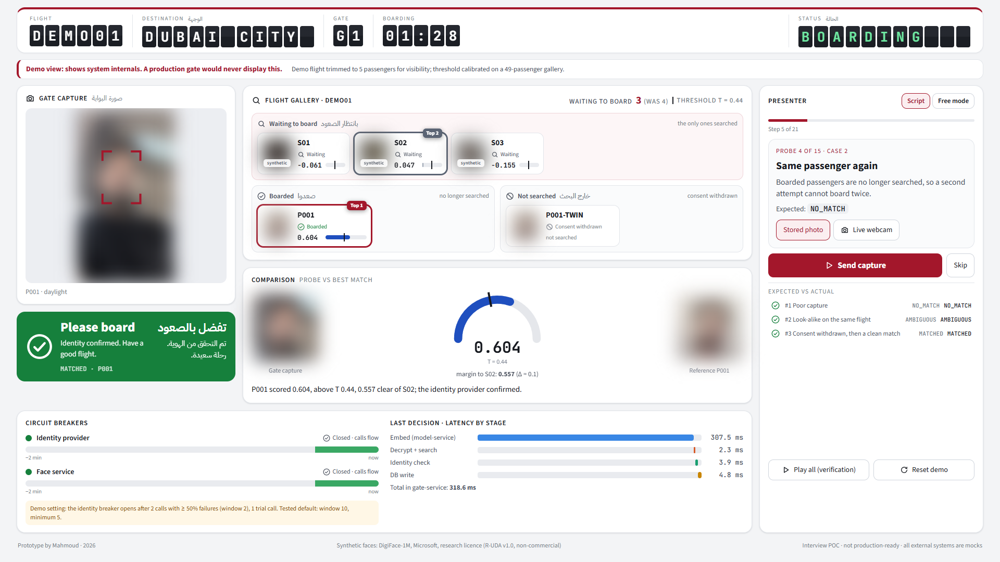
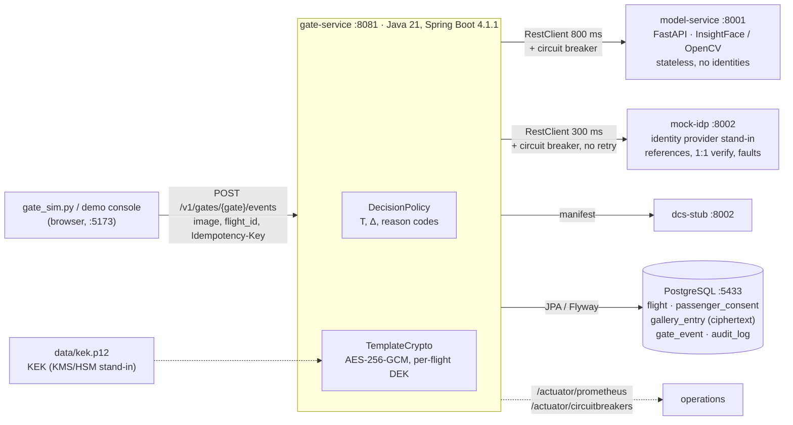
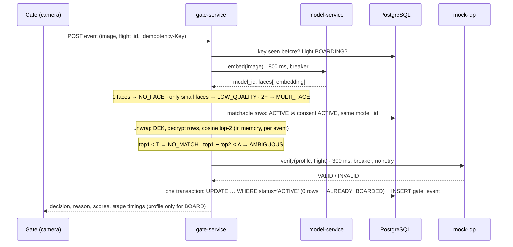
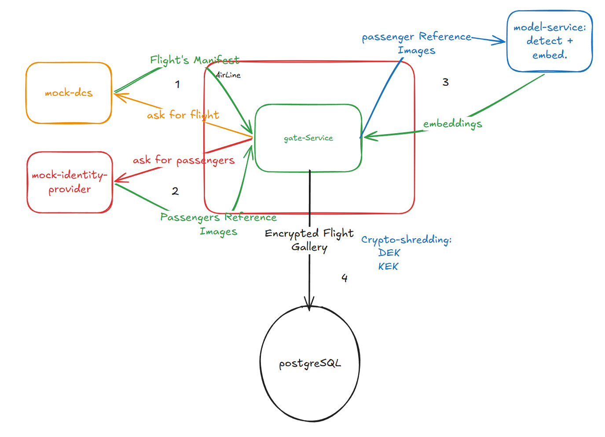
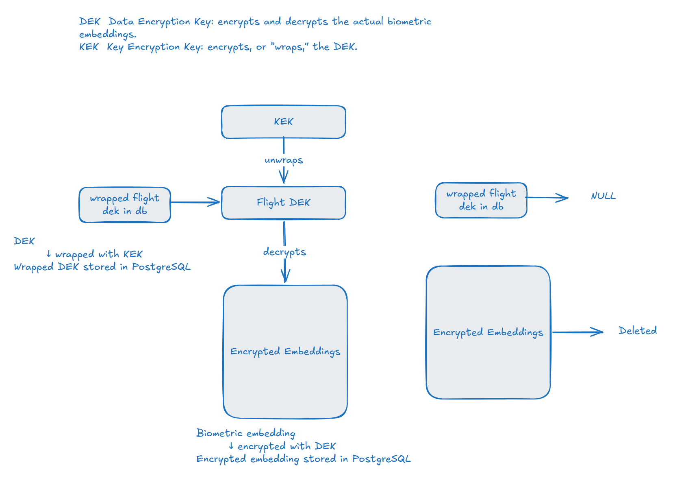
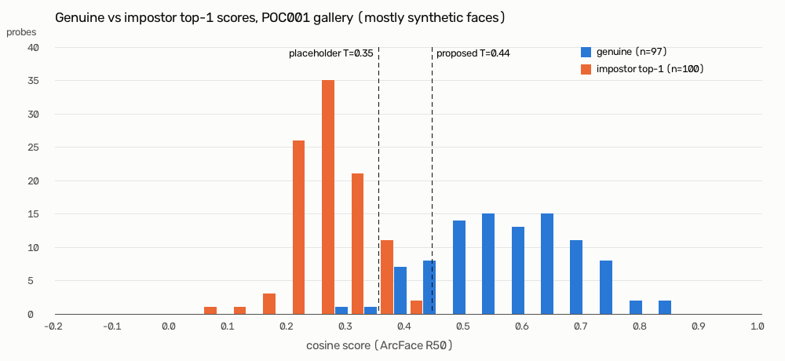

# Consent-first flight-gallery boarding gate (personal project)

https://github.com/user-attachments/assets/32325e61-052e-4b7e-8fb0-acc2fd38cd00

*Demo, 1 min 44 s, no sound. The X-ray console boards flight DEMO01: synthetic passengers board, while a poor
capture, a stranger, two faces and a tiny face all go to a person instead of guessing. Then the author, on a live
webcam, is first `AMBIGUOUS` against a look-alike profile, boards once the look-alike's consent is withdrawn, and the
flight is closed and crypto-shredded. The video shows the author's own face (published by choice) and synthetic faces
from DigiFace-1M, Microsoft, research licence (R-UDA v1.0, non-commercial); those images stay under the R-UDA terms
(§12).*

> **A 2-day personal prototype. Not production-ready.** Not affiliated with any airline or government agency: every
> external system here (identity provider, departure control) is a mock with a hypothetical API. Thresholds are
> illustrative. No accuracy claims.

**Run it yourself:** setup, services and demos in [§10 Running it](#10-running-it).



*The presenter-driven X-ray console (`gate-console/`, demo mode only) right after a BOARD: the passenger's tile has moved
to "Boarded" because the database says so, the comparison card shows score and margin against T and Δ, and the
waterfall splits the decision into embed, decrypt + search, identity check and DB write. **All face images are blurred
in this still**; the video above shows them (the author as the volunteer; synthetic faces from DigiFace-1M, research
licence).*

## 1. What this is

A boarding gate that matches a passenger 1:N against **only that flight's consented gallery**, anchored in a mock
external identity provider, and that falls back to **manual boarding on any failure**. It is built to discuss the
part of airport face recognition that an airline IT team plausibly owns: not the matcher, but everything around it.

- Match only against the flight's consented, enrolled passengers; boarded passengers leave the gallery.
- Too-close top-two scores (look-alikes) go to a human (`AMBIGUOUS`).
- Any failure (model down, identity provider slow or down, open circuit breaker, DB down) means `MANUAL` + reason.
- Consent is checked at query time; probes stay in memory; identity is logged only for `BOARD`.
- Templates are encrypted per flight and crypto-shredded after departure.

## 2. The problem it illustrates

Integration with an external identity anchor (P13), thresholds and gallery size (P1), degraded modes (P14) and
consent (P10), plus template security (P19) and retention (P12). Evidence: [`docs/research/phase1-problem.md`](docs/research/phase1-problem.md),
[`phase2-handoff.md`](docs/research/phase2-handoff.md). Gallery size is the main accuracy lever: NIST FRTE median FNIR
rises roughly 17x from 640k to 12M identities (see the research docs for sources).

## 3. Architecture



**Gate-event sequence** (any exception or open breaker → `MANUAL` + reason):



| Real | Mocked / stubbed |
|---|---|
| Face detection + embeddings (SCRFD-10G + ArcFace R50, or YuNet + SFace) | Identity provider (`mock-idp`, hypothetical API) |
| 1:N search, decision policy, consent filter | Departure control (`dcs-stub`) |
| AES-256-GCM envelope encryption, per-flight keys, crypto-shredding | KMS/HSM (a local PKCS12 keystore holds the KEK) |
| Circuit breakers, timeouts, idempotency, board-once update | Gate hardware (a CLI simulator and a browser console) |
| Metrics, tests | Operational images: one consenting volunteer + synthetic faces |

Details, sequence and contracts: [`docs/architecture.md`](docs/architecture.md). Decisions: [`docs/decisions/`](docs/decisions/).

### Design sketches

Hand-drawn system design (source: [`docs/architecture.excalidraw`](docs/architecture.excalidraw); open it at
excalidraw.com). The red box is the airline's boundary; everything outside it is an external system.

**Preparation, before boarding.** (1) gate-service asks `dcs-stub` for the flight manifest. (2) It asks `mock-idp` for
reference images, only for passengers with active consent. (3) model-service detects and embeds each face. (4) The
embeddings are encrypted with the flight's DEK and stored as that flight's gallery in PostgreSQL.



**At the gate.** The gate sends image + flight id + Idempotency-Key. model-service returns the face count and one
embedding; it never sees an identity. gate-service searches only the eligible gallery (active, consented, not yet
boarded), asks `mock-idp` to confirm the selected profile, marks the passenger boarded at most once, and returns
`BOARD` or `MANUAL` + reason to the gate.


## 4. Gate decision policy

1. Idempotency-Key seen before → the stored decision. 2. Flight not `BOARDING` → `GALLERY_UNAVAILABLE`.
3. Embed: 0 faces → `NO_FACE`, 2+ → `MULTI_FACE` (faces < 80 px are ignored as background; if *only* such small
faces are present → `LOW_QUALITY`, "please step closer", a size proxy, not an image-quality model); model failure →
`MODEL_UNAVAILABLE`; probe from another model than the gallery → `MODEL_MISMATCH`. 4. Search the flight's `ACTIVE`
entries **joined with `ACTIVE` consent at query time**; top-1 and top-2 cosine. 5. `top1 < T` → `NO_MATCH`;
`top1 − top2 < Δ` → `AMBIGUOUS`. 6. 1:1 confirm at the identity provider (300 ms, breaker, no retry): failure →
`IDP_UNAVAILABLE`, `INVALID` → `IDP_REJECTED`. 7. One transaction: `UPDATE … SET status='BOARDED' WHERE id=? AND
status='ACTIVE'` (0 rows → `ALREADY_BOARDED`) + insert `gate_event`.

**Thresholds are illustrative.** R50 `T = 0.44` was set from the score analysis in §9 (the original placeholder was
0.35); SFace `T = 0.363` is the OpenCV Zoo default, not analysed; margin `Δ = 0.10` is a placeholder. None of them is
calibrated at a target FPIR on operational data.

## 5. Privacy and security

- **Consent** is checked when the gallery is built (non-consented passengers are never fetched) **and** on every match
  (SQL join), so a withdrawal applies from the next gate event. Withdrawal also deletes the matchable template.
- **Minimisation:** probe images are processed in memory only; reference images are fetched, embedded and
  discarded; the model-service only computes a template when exactly one face is in the zone; EXIF is stripped.
- **Logging:** one structured line per decision, never images or embeddings; `profile_id` only for `BOARD`
  (tested). Metrics carry no identity.
- **Encryption:** AES-256-GCM, 96-bit random IV, 128-bit tag, AAD = `flight|profile|model` (a row copied to another
  profile does not decrypt). One data key (DEK) per flight, stored only wrapped by a key-encryption key (KEK) from a
  local PKCS12 keystore standing in for a KMS/HSM. **No plaintext cache:** the DEK is unwrapped and the matchable rows
  are decrypted per gate event (cost measured in §8).
- **Retention:** after departure plus a grace period, `PurgeJob` deletes the gallery rows **and the wrapped DEK**
  (crypto-shredding) and writes an audit row. A test proves that even a copied ciphertext can no longer be decrypted.
- **Honest limits:** decrypted templates sit in JVM memory while an event is processed; the KEK is in a file, not an
  HSM; an airline-held key is **not** the EDPB "passenger-held key" scenario; walk-through cameras still *detect*
  people who have not consented (the POC minimises what happens next, it cannot prevent the capture).



*Left: during matching, the KEK unwraps the flight's DEK, which decrypts the embeddings in memory. Right: after
departure the wrapped DEK is removed and the gallery rows are deleted, so any leftover copy of the ciphertext can no
longer be decrypted.*

## 6. Resilience and fallback

| Failure | Behaviour | Test |
|---|---|---|
| Identity provider slow (2 s) | `IDP_UNAVAILABLE` within the 300 ms timeout | `ResilienceIT.slowIdentityProvider…` |
| Identity provider down (500 / connection reset) | `IDP_UNAVAILABLE`; after 5 calls ≥ 50% failed the breaker opens and rejects instantly; HALF_OPEN recovers | `ResilienceIT` (3 tests) |
| Model-service down or slow | `MODEL_UNAVAILABLE` | `ResilienceIT` (2 tests) |
| Identity provider down during gallery build | Flight stays `BUILDING` → whole flight boards manually | `ResilienceIT.identityProviderDownDuringGalleryBuild…` |
| Duplicate gate event (client retry) | Stored decision returned, nothing reprocessed | `BoardingIT.duplicateIdempotencyKey…` |
| Two gates, same passenger, same moment | Exactly one `BOARD`, the other `ALREADY_BOARDED` | `BoardingIT.twoGatesSamePassenger…` |
| Consent withdrawn mid-boarding | `NO_MATCH` on the next attempt | `BoardingIT.consentWithdrawn…` |
| Look-alikes in the same flight | `AMBIGUOUS` → manual | `BoardingIT.lookAlikes…`, `DecisionPolicyTest` |
| Non-enrolled person | `NO_MATCH`, no identity in logs | `BoardingIT.strangerIsNoMatchAndNoIdentityIsLogged` |
| Database down | HTTP 503 with body `MANUAL / DB_UNAVAILABLE` (the simulator also treats any non-200 as manual) | `ApiExceptionHandlerTest` |

Breakers (Resilience4j): window of 10 calls, minimum 5, 50% failure or slow-call rate, slow call > 300 ms
(800 ms for the model), 10 s open, 2 half-open trial calls. **No retry on the hot path:** a retry doubles the wait at
the gate and adds load to a struggling dependency; a fast manual decision keeps the queue moving. A gallery rebuild
preserves boarded state (tested), and a departed flight cannot be rebuilt.

## 7. Observability

Metrics at `/actuator/prometheus`: `gate_decisions_total{gate,decision,reason}`, `gate_decision_seconds`,
`gate_gallery_search_seconds`, `gate_match_top1_score`, `gate_match_margin`, plus Resilience4j breaker state and call
counts. Example PromQL: manual-fallback rate per gate
`sum by (gate)(rate(gate_decisions_total{decision="MANUAL"}[5m])) / sum by (gate)(rate(gate_decisions_total[5m]))`.
Proposed SLOs (targets for discussion, not agreements): p95 decision latency ≤ 1 s; manual-fallback rate per gate
within an agreed budget; alert when a breaker stays OPEN > 1 min. FNIR is not observable live, so monitor proxies:
reason mix, score and margin drift, and audited outcomes of manual checks.

## 8. Latency: GPU vs CPU

Hardware: Intel Core i5-14400F (10 cores / 16 threads), NVIDIA GeForce RTX 4060 8 GB (driver 591.86, CUDA 13 via
onnxruntime-gpu 1.30.0 pip wheels), 15.8 GB RAM, Windows 11 Pro, Python 3.11.9, gate-service on JDK 25.
Method: `tools/bench_latency.py`, N = 200 after 20 warm-up requests, one real 899×1599 capture, gallery = seeded
POC001 (49 entries), all services on one desktop. Full table: [`docs/latency.md`](docs/latency.md).

| Mode | model-service round trip p50 / p95 (ms) | detect p50 / p95 | embed p50 / p95 | end-to-end decision p50 / p95 | per-event unwrap + decrypt + search p50 / p95 |
|---|---|---|---|---|---|
| GPU (`cuda`) | 23.6 / 24.6 | 12.1 / 12.7 | 4.5 / 4.8 | **50.9 / 55.7** | 2.6 / 5.7 |
| CPU, all threads (`cpu`) | 363.3 / 457.9 | 142.8 / 195.8 | 207.0 / 292.6 | **456.6 / 565.4** | 26.7 / 45.6 |
| CPU, 4 threads (`cpu4`, edge proxy) | 158.4 / 173.9 | 75.5 / 88.9 | 74.8 / 82.3 | **177.1 / 192.7** | 2.2 / 2.6 |

End-to-end = multipart POST to the gate-service: embed + gallery search + 1:1 confirm at the local mock + DB write
(P001 set to `INVALID` for the run so every event takes the full path; the final board `UPDATE` is not exercised).
Phase 3 cloud reference (2 vCPU, no GPU): SCRFD-10G@640 ≈ 130 ms, R50 ≈ 138 ms per face. `cpu4` caps ONNX Runtime
intra-op threads at 4 by building the sessions directly, because InsightFace `get_model` ignores `sess_options`
(InsightFace issue #2899). **Not a performance claim:** one desktop, one image, local mocks.

## 9. Findings

1. **The placeholder threshold let impostors through.** On the seeded 49-identity gallery, 13 of 100 impostor top-1
   scores were ≥ 0.35: each is a plausible false match when the true passenger is absent from the gallery. The
   highest impostor top-1 seen was 0.413, so T was set to **0.44** (+0.02 gap, rounded up). The price: 16 of 97
   genuine probes now go to manual (2 at 0.35), including the volunteer's night capture (0.420). That is the
   automation-for-safety trade-off, visible in numbers. With 100 impostor searches the rule of three bounds the
   false-match rate only at ~3% per search, so this is far too little data to calibrate anything. **The faces are
   mostly synthetic (DigiFace-1M), which may not behave like real faces: this shows the method, not operational
   numbers.** Details and histogram: [`docs/score-analysis.md`](docs/score-analysis.md).
   
2. **Reference quality decides which identity wins, not just the score.** The same probe scored **0.831** against a
   phone-quality reference and **0.604** against the volunteer's ID-document reference. Enrolled as two profiles on
   one flight, the gate confidently boarded the wrong profile (margin 0.227 > Δ): the margin rule only protects you
   when look-alike scores are *close*. Reproduce with `python tools/seed.py --twin-from-photo`. The demo's look-alike
   is instead a **simulated** one (a re-cropped, re-compressed copy of the same ID reference): 0.604 vs 0.602 →
   `AMBIGUOUS`.
3. **Cap CPU threads on shared hosts.** Inside the service, ONNX Runtime's default thread pool (all cores) was 2–3×
   *slower* than 4 threads and slowed the co-located JVM too (gallery search 26.7 ms vs 2.6 ms). The standalone smoke
   test on the same machine does not show this (47 ms detect / 41 ms R50 with all threads), which points to thread
   oversubscription (possibly with this CPU's performance/efficiency cores), not the model. Not investigated further;
   measure on the target gate hardware.

## 10. Running it

Everything runs locally: PostgreSQL in Docker, the three services natively. Commands are **Windows PowerShell**, run
from the repository root unless a line starts with `cd`; on Linux/macOS use `.venv/bin/python`, `./mvnw` and
`export NAME=value` instead (GPU mode is only tested on Windows).

### 10.1 Prerequisites

| Tool | Version | Used for |
|---|---|---|
| Git | any | cloning |
| Python | **3.11** | model-service, mocks, tools |
| Docker Desktop | running | PostgreSQL 17 on `localhost:5433` |
| JDK | 21 or newer (built with 25) | gate-service (Maven comes with the wrapper); `keytool` |
| Node.js | 22 LTS or newer | the demo console only |
| NVIDIA GPU | optional | `DEVICE=cuda`; everything also runs on CPU |

Ports used: 5433 (Postgres), 8001 (model-service), 8002 (mocks), 8081 (gate-service), 5173 (console).

### 10.2 One-time setup

```powershell
git clone https://github.com/mmmacmp/boarding-gate-face-recognition.git
cd boarding-gate-face-recognition

# Python environment
py -3.11 -m venv .venv
.\.venv\Scripts\pip install -r model-service/requirements.txt -r mocks/requirements.txt -r tools/requirements.txt
.\.venv\Scripts\pip uninstall -y onnxruntime onnxruntime-gpu
.\.venv\Scripts\pip install "onnxruntime-gpu[cuda,cudnn]==1.30.0"   # CUDA 13 driver; CUDA 12: ==1.26.0
# no NVIDIA GPU instead:  .\.venv\Scripts\pip install onnxruntime==1.30.0   (and use DEVICE=cpu below)

# Face models: InsightFace buffalo_l (~330 MB, non-commercial research only) goes to ~/.insightface/models/;
# YuNet + SFace (~40 MB, MIT / Apache-2.0) go to model-service/models/
cd model-service; ..\.venv\Scripts\python download_models.py; cd ..

# Synthetic passengers: a 50-identity DigiFace-1M subset via HTTP range requests (research licence, stays local)
.\.venv\Scripts\python tools\fetch_digiface_subset.py

# Key-encryption key in a local keystore (stand-in for a KMS/HSM); choose your own password
New-Item -ItemType Directory -Force data | Out-Null
keytool -genseckey -alias kek -keyalg AES -keysize 256 -storetype PKCS12 -keystore data\kek.p12 -storepass <password>
Set-Content -Encoding ascii data\local-secrets.properties "gate.kek.password=<password>"

# Demo console (optional)
cd gate-console; npm install; cd ..
```

Everything in `data/` is gitignored: keys, synthetic faces and your photos never leave your machine. The first
setup downloads about 2.5 GB (most of it the CUDA libraries inside `.venv`; far less for CPU only).

### 10.3 Add yourself as the volunteer

The scripted demo and the X-ray console need one real, consenting person as passenger `P001`. Use yourself (or
someone who has agreed); never web or celebrity images. Without `P001`, flight POC001 is seeded with synthetic
passengers only and you can still run single captures (§10.5 B).

```
data/volunteers/P001/reference.jpg    # enrolment photo (what mock-idp serves): frontal, face at least ~150 px wide
data/volunteers/P001/probe.jpg        # gate capture 1: easy (daylight, frontal)
data/volunteers/P001/probe_02.jpg     # gate capture 2: hard (night, low angle); add probe_03.* ... as needed
```

`.jpg`, `.jpeg` and `.png` all work; EXIF is stripped before any image leaves the tools. One face per photo.

### 10.4 Start the services

Four terminals, each started from the repository root:

```powershell
# 1. PostgreSQL (also creates the gate_test database for integration tests)
docker compose -f ops/docker-compose.yml up -d --wait db

# 2. model-service on :8001 (DEVICE=cpu without a GPU; MODEL=sface for the license-clean models)
cd model-service; $env:DEVICE="cuda"; ..\.venv\Scripts\python -m uvicorn app.main:app --port 8001

# 3. mocks (mock-idp + dcs-stub) on :8002
cd mocks; ..\.venv\Scripts\python -m uvicorn main:app --port 8002

# 4. gate-service on :8081 (the two retention settings make the depart + crypto-shred step quick to watch)
cd gate-service; $env:GATE_RETENTION_GRACE="10s"; $env:GATE_RETENTION_PURGE_INTERVAL="5s"; .\mvnw.cmd spring-boot:run
```

Check: `curl http://localhost:8081/actuator/health` reports `"status":"UP"`.

### 10.5 Try it

**A. Scripted demo in the terminal** (needs `P001`, about 40 s): resets the database, seeds the flights, then shows
matching against only the flight's consented gallery, boarded passengers leaving it, a stranger, consent withdrawal at
query time, a slow identity provider opening the circuit breaker, a simulated look-alike going to `AMBIGUOUS`, and
crypto-shredding after departure.

```powershell
.\.venv\Scripts\python tools\gate_sim.py --scenario demo
```

**B. Single captures:**

```powershell
.\.venv\Scripts\python tools\seed.py                                   # flights POC001 + POC002 (needs services up)
.\.venv\Scripts\python tools\gate_sim.py --profile S001 --probe 1      # a synthetic passenger -> BOARD
.\.venv\Scripts\python tools\gate_sim.py --profile STRANGER --probe 1  # never enrolled -> NO_MATCH, manual
.\.venv\Scripts\python tools\gate_sim.py --profile P001                # your own probes
```

**C. Demo console** (`gate-console/`, React 19 + Vite 8, plain CSS): `cd gate-console; npm run dev`, then open
http://localhost:5173. The gate panel sends demo captures (volunteer day/night photos, a simulated look-alike on
POC002, a synthetic stranger, the next synthetic passenger) or a webcam capture, and shows a signage-style decision
banner with the reason in plain English plus score bars against T and Δ. The operations panel shows gallery counts,
the manual-fallback rate over the last 20 events, both breakers with a 3-minute state timeline, the per-stage latency
of the last decision, fault buttons (slow / down identity provider, model down), consent withdrawal, a "reset demo"
button and recent events. The Vite dev server proxies every call, so the services need no CORS. Identity is shown
only for `BOARD`.

**D. Presenter demo (X-ray view, flight DEMO01; the video at the top).** A 5-passenger demo flight (P001, the simulated
look-alike P001-TWIN, and synthetic S01–S03) with a 15-probe script that covers every decision path: poor capture,
look-alike, consent withdrawal, clean BOARD, boarded-not-searched, idempotent replay, stranger, no face, two faces,
face too small, identity provider INVALID / slow, breaker OPEN and recovery, face service down, and depart +
crypto-shred. Nothing runs until the presenter clicks; every probe shows expected vs actual. POC001 (49 passengers) is
unchanged for the benchmark and the score analysis. Demo mode is off by default; restart mocks and gate-service with
the two switches below:

```powershell
.\.venv\Scripts\python tools\make_demo_assets.py      # once, with model-service running: S01-S03 + special probes in data/demo/
$env:DEMO_XRAY="true"; cd mocks; ..\.venv\Scripts\python -m uvicorn main:app --port 8002          # terminal 3: thumbnails
$env:SPRING_PROFILES_ACTIVE="demo"; cd gate-service; .\mvnw.cmd spring-boot:run                  # terminal 4: application-demo.yml
.\.venv\Scripts\python tools\demo_scenario.py --reset                         # full reset incl. DEMO01 (~20 s)
cd gate-console; npm run dev                                                   # http://localhost:5173, "Reset demo" ~10 s
```

The demo profile uses a **demo-only** identity breaker (window 2, minimum 2 calls, 5 s open, 1 trial call; labelled in
the console) and a 3 s purge grace; the tested defaults are unchanged. Rehearsal checklist:
[`docs/demo-rehearsal.md`](docs/demo-rehearsal.md).

**Reset.** Rebuilding a gallery deliberately keeps boarded state, so to start over, empty the tables:

```powershell
docker compose -f ops/docker-compose.yml exec -T db psql -U poc -d gate -c "TRUNCATE flight, passenger_consent, gallery_entry, gate_event, outbox, audit_log"
```

### 10.6 Tests

```powershell
cd gate-service; .\mvnw.cmd test        # unit tests, no database
cd gate-service; .\mvnw.cmd verify      # + integration tests against the compose database; JaCoCo in target/site/jacoco
cd model-service; ..\.venv\Scripts\python -m pytest
cd mocks; ..\.venv\Scripts\python -m pytest
```

### 10.7 Troubleshooting

- **`DEVICE=cuda` fails to start:** the ONNX Runtime build must match the driver's CUDA major version (1.30.0 for
  CUDA 13, 1.26.0 for CUDA 12). `DEVICE=cpu` always works; latency is in §8.
- **Port already in use:** Postgres is mapped to 5433 so it does not clash with a local PostgreSQL on 5432; the
  gate-service uses 8081 because 8080 is often taken. Service URLs live in
  `gate-service/src/main/resources/application.yml`.
- **Every decision is `MANUAL` with `GALLERY_UNAVAILABLE`:** the flight is not seeded or not `BOARDING`; run `seed.py`
  (or the scripted demo, which seeds).
- **gate-service fails at startup on the keystore:** `data/kek.p12` or the password in
  `data/local-secrets.properties` is missing; the `GATE_KEK_PASSWORD` environment variable also works.

## 11. Tests and coverage

- gate-service: 37 unit tests (`mvnw test`, no DB) + 24 integration tests (`mvnw verify`, real Postgres `gate_test`,
  WireMock for all HTTP dependencies). One test per failure-mode row, plus tests proving the demo X-ray features are
  **off by default** (404, no `xray` block) and correct when enabled. `DecisionPolicy` and `TemplateCrypto` tests were
  written first. JaCoCo report in `gate-service/target/site/jacoco`.
- model-service: 21 pytest tests (fake-backend contract tests + real-model tests; photo tests skip without `data/`).
- mocks: 16 pytest tests (incl. the demo thumbnail endpoint being off by default).
- Demo script: the 15 DEMO01 probes were run end to end 6 times from a reset (2× "Play all", 4× scripted clicks in a
  headless 1920×1080 browser): 90 of 90 outcomes matched.
- Gap to "100% unit tests in CI": no CI pipeline; controllers and the console endpoints (`/v1/events`,
  `/v1/policy`) are covered mainly through the end-to-end demo; the console itself has no automated tests.

## 12. Models, data and licences

- **InsightFace `buffalo_l` (SCRFD-10G + ArcFace R50): weights are non-commercial research only** (code MIT).
- **License-clean mode:** `MODEL=sface` (YuNet + SFace, OpenCV Zoo, MIT / Apache-2.0). Runs on CPU only here.
- **Synthetic passengers: DigiFace-1M** (Microsoft, WACV 2023, https://github.com/microsoft/DigiFace1M), Research Use of
  Data Agreement v1.0, **non-commercial research only**; a 49-identity subset (+1 stranger) fetched with HTTP range
  requests, kept local (gitignored). One identity (S035) is excluded because its reference face is below the 150 px
  enrolment guideline. The X-ray demo shows a handful of these images on screen with the attribution line
  "Synthetic faces: DigiFace-1M, Microsoft, research licence (R-UDA v1.0, non-commercial)"; §5.5 of the licence allows
  de minimis portions to explain use, and §3.1 requires anyone who redistributes the data (e.g. a recording) to pass on
  the credit and bind recipients to the R-UDA terms. Citation: G. Bae, M. de La Gorce, T. Baltrušaitis, C. Hewitt,
  D. Chen, J. Valentin, R. Cipolla, J. Shen, "DigiFace-1M: 1 Million Digital Face Images for Face Recognition",
  WACV 2023.
- **Volunteer photos:** one consenting volunteer (the author), local only, never committed. The demo video at the top
  shows the author's own face by the author's choice; it is hosted as a GitHub attachment, not committed. Screenshots of the X-ray
  view (they show faces) stay in the gitignored `docs/img/xray/`; the README image has every face blurred.

## 13. Production gaps

Explicit, not exhaustive:
- **Matcher and PAD:** no certified matcher (NIST-evaluated vendor SDK); no certified PAD (iBeta ISO/IEC 30107-3,
  NIR/3D). Non-commercial model weights.
- **Thresholds:** not calibrated at a target FPIR on operational data; only a tiny, mostly synthetic set was analysed;
  no demographic evaluation (ISO/IEC 19795-10).
- **Integrations:** no real identity-provider or DCS contract, no mTLS or message signing; the outbox to the DCS was
  skipped. No legal review (PDPL/GDPR), no DPIA.
- **Keys:** the KEK is a local keystore, not an HSM/KMS; no key rotation. **Crypto-shredding is only as good as key
  retention:** here the wrapped DEK lives in the same database as the ciphertext, so a database backup taken before
  the purge still contains both and remains decryptable with the KEK. In production the DEKs would live in a KMS with
  their own retention, separate from data backups.
- **Memory:** decrypted templates sit in JVM memory while an event is processed.
- **Audit:** the consent-withdrawal audit row has no subject reference, so the audit trail cannot show *who*
  withdrew; a real design needs a pseudonymous subject reference with its own retention.
- **Operations:** single instance; no HA/DR, Kubernetes, or load test at an A380 boarding peak; no agreed SLOs or
  runbooks; no threat model or penetration test; the model-service serialises inference with one lock (one gate).
- **Capture:** no multi-camera walk-through, tailgating control or accessibility handling (children, PRM, face
  coverings); "low quality" is only a face-size proxy, not an image-quality model (eDifFIQA / OFIQ).
- **Demo X-ray mode:** per-candidate scores keyed by profile id, a pseudonymous gallery view and reference thumbnails
  exist only behind `demo.xray` / `DEMO_XRAY` (default off, tested). A production gate would never expose them; the
  demo profile also uses a faster breaker (window 2) and a 3 s purge grace.
- **Console:** a local dev tool (Vite dev server, no authentication); its reset and fault controls must never exist in
  a production gate UI.

## 14. What I'd ask and do next

Questions this POC leads into (not publicly known):
1. Where does 1:N matching run for boarding today: gate device, an airline service, or the identity provider? Does
   the gate receive a decision or scores?
2. When the identity-provider link degrades mid-boarding, is the policy manual for everyone or local matching with
   reconciliation? Who owns that decision, and how is it rehearsed?
3. How is the boarding gallery scoped (manifest only, boarded exclusion, transfers), and how are thresholds and
   margins tuned and monitored per gate?
4. When the matcher is upgraded, who re-extracts templates from reference images, and how is it canaried?
5. What is retained after departure (images, templates, logs), and how are consent withdrawal and EU passengers
   handled?

Next: shadow-scoring a candidate model (template versioning is already in place via `model_id`), a React agent
console, quality feedback (eDifFIQA) and passive PAD flags, CI with the JaCoCo report.

## 15. How AI tools were used

Claude Code was used for research, scaffolding and code. Every line was reviewed; correctness was validated with
tests (written first for the policy and crypto), measured smoke tests and benchmarks rather than generated claims;
the Java walkthrough (`docs/WALKTHROUGH.md`) is written by the author.

## 16. References

Research and sources: [`docs/research/`](docs/research/) (phases 1–4, smoke-test results).
