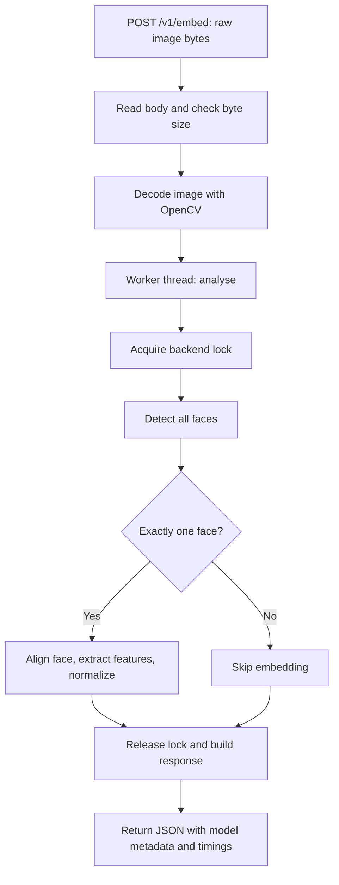

# Model service code walkthrough

This service turns an image into face locations and, when exactly one face is
present, a face embedding: a numeric vector representing features of that face.
It is a FastAPI proof of concept standing in for a vendor matcher SDK.

The service does not know who a person is, store their image or embedding, compare
against enrolled identities, or decide whether to open a gate. Its caller, the
gate-service, owns matching and decisions. Detection confidence (`det_score`)
describes a detected face, not confidence in someone's identity.

## Where to start reading

| File | Responsibility |
| --- | --- |
| `app/main.py` | Application construction, startup, HTTP endpoints, inference coordination |
| `app/settings.py` | Environment variables, defaults, configuration validation |
| `app/models.py` | Model loading, detection, face alignment, embedding normalization |
| `app/schemas.py` | Pydantic response models defining the JSON contract |
| `download_models.py` | Download model weights before running the service |
| `tests/test_api_contract.py` | HTTP behavior using a fake model backend |
| `tests/test_models.py` | Actual CPU model checks, with optional volunteer photos |
| `tests/conftest.py` | Image helpers and reusable real-model clients |

## 1. Application startup

Run `uvicorn app.main:app --port 8001` from this directory in an environment with
the project dependencies and an appropriate ONNX Runtime installation. The
dependency setup notes live in `requirements.txt`.

1. Uvicorn imports `app.main`. The final line calls `load_settings()` and passes
   the resulting immutable `Settings` object to `create_app()`.
2. `create_app()` creates backend state, a thread lock, and the FastAPI routes.
   Model weights are not loaded just by constructing this app.
3. FastAPI enters `lifespan()` before serving requests. Unless a backend was
   injected by a test, `load_backend()` constructs R50 or SFace.
4. `lifespan()` calls `warmup()` three times. Each call runs both detection and
   recognition on synthetic arrays, so the first passenger does not pay their
   initialization cost. A blank frame alone would not exercise recognition.
5. The `yield` hands control back to FastAPI to serve traffic. There is currently
   no custom cleanup after it.

The backend is reused across requests. "Stateless" here means no retained
passenger records; it does not mean reloading models for every image. Tests can
inject `FakeBackend` because it exposes the same methods and metadata as the real
backends, without requiring inheritance from a shared base class.

## 2. One image request

The HTTP handler `embed()` takes raw encoded image bytes, rather than JSON,
base64, or a multipart upload. Empty bodies and undecodable images return HTTP
400; bodies above `MAX_IMAGE_BYTES` return HTTP 413. OpenCV decodes the image into
a NumPy array in BGR channel order. The handler does not enforce a Content-Type
header; decoding determines whether it accepts the image.

`run_in_threadpool(analyse, img)` moves synchronous model work off the async event
loop. Inside `analyse()`, a lock protects the shared detector and recognizer.
Multiple requests can arrive concurrently, but their inference is serialized
within this app instance. Reading and decoding happen before the worker call;
image decoding itself still runs in the async handler.

`analyse()` always detects first. With zero faces, it returns an empty `faces`
list. With multiple faces, it returns their boxes and detection scores without
computing any embeddings. With exactly one face, it also calls the backend's
`embed()` method. This avoids computing bystanders' biometric templates.

Finally, it builds `FaceOut` objects and an `EmbedResponse`. NumPy embeddings are
converted to ordinary Python lists for JSON. The route's
`response_model_exclude_none=True` omits absent embeddings instead of emitting
`"embedding": null`.

## 3. What the model functions do

| Backend | Detection | Recognition | Embedding size | Device in this implementation |
| --- | --- | --- | --- | --- |
| `R50Backend` | SCRFD | ArcFace R50 | 512 | CPU or CUDA |
| `SFaceBackend` | YuNet | SFace | 128 | CPU |

Both provide `detect(img)`, `embed(img, face)`, and `warmup()`, plus `model_id`,
`dim`, `device`, and `providers`. This lets the API use either implementation
without branching on the model for every request.

- `detect()` returns internal `Face` objects. Each has a box in pixel coordinates
  `[x1, y1, x2, y2]`, a detection score, and alignment data. R50 keeps all detected
  faces via `max_num=0`. SFace converts YuNet's `[x, y, width, height]` boxes to
  corner coordinates and stores the complete detection row for `alignCrop()`.
- `embed()` aligns the detected face into a consistent crop before passing it to
  the recognizer. Alignment uses facial landmark positions to reduce variation
  from position, scale, and rotation. Both paths normalize the resulting vector.
- `_normalise()` flattens features to a float32 vector and divides by its L2 norm
  (its length). For unit vectors, a dot product gives cosine similarity. This
  function assumes a finite, nonzero model output; it does not guard against a
  zero norm. Comparing vectors belongs to the caller and requires the same
  `model_id`; R50 and SFace outputs are not interchangeable.
- `_ort_session()` builds R50's ONNX Runtime sessions with the requested thread
  settings and execution providers. A CUDA request raises an error if CUDA is not
  the session's first active provider, avoiding an unnoticed whole-session CPU
  fallback. CPU remains a secondary provider in a CUDA session.

## 4. Configuration and weights

| Environment variable | Default | Effect |
| --- | --- | --- |
| `MODEL` | `r50` | Select `r50` or `sface` |
| `DEVICE` | `cpu` | Request `cpu` or `cuda`; SFace uses CPU regardless |
| `CPU_THREADS` | `0` | Leave library defaults; a nonzero value sets the thread count |
| `DET_SIZE` | `640` | R50 detector's square input size; not used by SFace |
| `MAX_IMAGE_BYTES` | `5242880` | Maximum encoded request image size (5 MiB) |
| `MODELS_DIR` | This project's `models/` directory | Runtime location of SFace/YuNet files |

`Settings.__post_init__()` validates model and device names. Environment parsing
converts numeric strings to integers but does not validate their ranges. Settings
are read when the module-level app is constructed, so environment changes require
recreating the app, typically by restarting the process.

`python download_models.py` fetches both model families. It puts OpenCV files in
the default project `models/` directory and lets InsightFace manage its
`~/.insightface/models/` cache. The script does not honor `MODELS_DIR`; a custom
runtime directory must contain the OpenCV files separately. R50 can also download
its weights during startup; SFace raises an error when local files are missing.

## 5. Response fields and observability

- `model_id` identifies the embedding model; `dim` is its vector size, even if no
  embedding was produced for this image.
- `faces` contains boxes, detection scores, and an embedding only for a single
  detected face. Internal alignment data is never returned.
- `timings_ms.detect` and `timings_ms.embed` measure work inside the lock. When
  embedding is skipped, its measured interval should be near zero.
- `timings_ms.total` includes body reading, decoding, worker scheduling, waiting
  for the lock, inference, and response construction. It excludes later JSON
  serialization and network delivery, so it is not full client-observed latency.
- `GET /health` reports loaded-backend metadata, including the actual device. It
  does not run a fresh model check.
- `GET /metrics` exposes Prometheus instrumentation for HTTP traffic.

The byte limit is checked after the full body is read and does not limit decoded
pixel dimensions. Images and embeddings are processed in memory; model weights
are separate files cached on disk.

## 6. How tests follow the flow

`python -m pytest tests/test_api_contract.py -q` exercises the HTTP contract with
`FakeBackend`: zero, one, and multiple faces; embedding call counts; invalid and
oversized inputs; health metadata; and metrics. It needs installed Python
dependencies but does not need model weights or photos.

`python -m pytest tests/test_models.py -q` uses real CPU inference. R50 startup
may download weights; SFace tests skip when the recognition file is absent.
Photo-based checks require volunteer references under the parent project's
`data/volunteers/*/reference.jpg` and otherwise skip. The real-model fixtures use
`with TestClient(...)` to run startup and warm-up before making requests.
